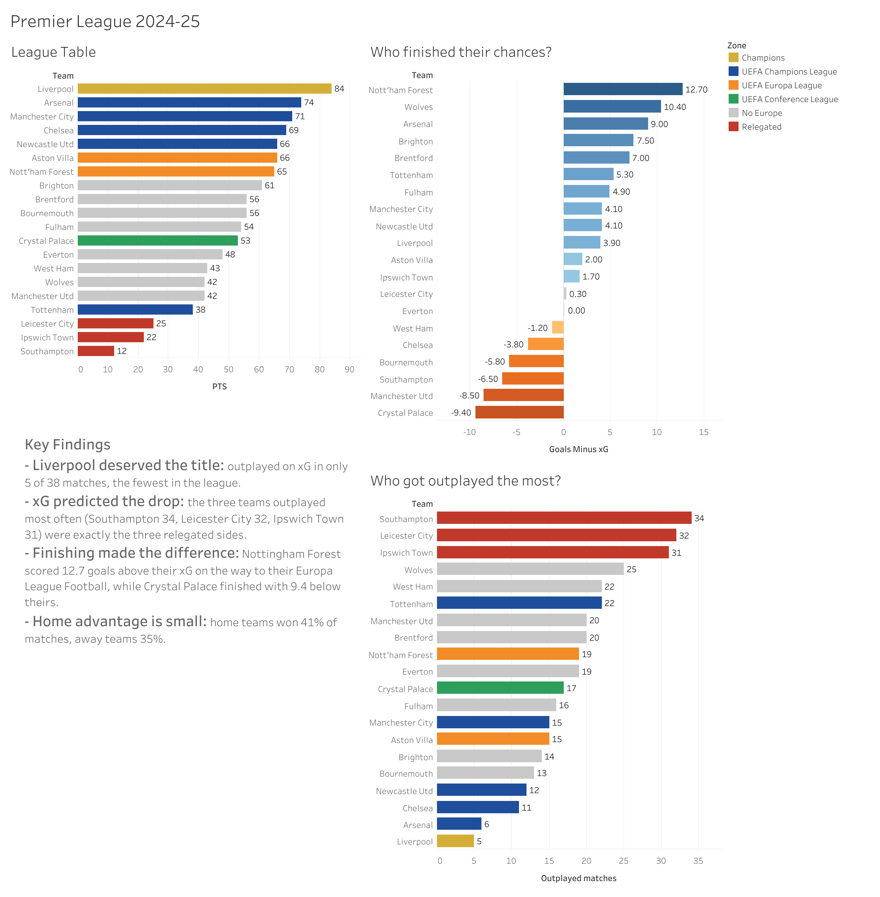

# Premier League 2024-25: Did the Table Tell the Truth?

An end-to-end analysis of the 2024-25 Premier League season. I used **SQL (SQLite)** in **Google Colab** to clean and model match-level data, then built an interactive **Tableau** dashboard to compare the final table with the underlying performance data (expected goals, xG).

**Interactive dashboard:** [View on Tableau Public](https://public.tableau.com/app/profile/sochea.putheesiddh/viz/PremierLeague2024-25Analysis/PremierLeague2024-25)

---

## Questions
1. Did the champions deserve the title, or did they get lucky?
2. Could xG (expected goals) have predicted which teams got relegated?
3. Which teams finished their chances better or worse than expected?
4. How big is home advantage in the Premier League?

## Key findings
- **Liverpool deserved the title.** They were outplayed on xG in only **5 of 38** matches, the fewest in the league. Their goals were only +3.9 above xG, so they won by creating chances, not by lucky finishing.
- **xG predicted the drop.** The three teams outplayed most often (**Southampton 34, Leicester 32, Ipswich 31**) were exactly the three relegated sides, with a clear gap to the next team (Wolves, 25).
- **Finishing made the difference.** Nottingham Forest scored **12.7 goals above their xG** on the way to the Europa League. Crystal Palace finished **9.4 below** theirs, the worst in the league.
- **Home advantage is small.** Home teams won **41%** of matches, away teams **35%**, and 24% were draws. Away teams had the higher xG in 43% of matches.

## Tools
| Tool | Used for |
|---|---|
| Google Colab | Notebook environment |
| Python (pandas, sqlite3) | Loading 15 CSV files into a SQLite database, exporting results |
| SQL (SQLite, JupySQL) | Cleaning, modelling and analysis |
| Tableau Public | Interactive dashboard |

## Data
[Premier League 2024-2025 Data](https://www.kaggle.com/datasets/furkanark/premier-league-2024-2025-data) (Kaggle): 380 matches with scores, xG, venues and team and player stats.

## Process

### 1. Data cleaning
- The `score` column stored results as text (e.g. `2–1`) using an **en dash (–)** instead of a hyphen, which broke simple string matching. I used `INSTR`, `SUBSTR` and `CHAR(8211)` to split it into numeric home and away goals.
- Quality check: confirmed that **0 of 380** scores failed to split.

### 2. Data model (SQL views)
- `matches`: the raw matches plus integer `home_goals` and `away_goals`
- `team_matches`: each match turned into **two rows**, one from each team's perspective (760 rows), using `UNION ALL`. This makes "per team" analysis straightforward.
- `league_table`: W / D / L / GF / GA / GD / PTS built with `SUM(CASE WHEN ...)` and `GROUP BY`

### 3. Validation
I rebuilt the final league table from raw match data and checked it against the official table (Liverpool 84 pts ... Southampton 12). Every row matched. I also spot-checked individual results (e.g. Ipswich 0-2 Liverpool) to catch a reversed home/away bug in an early version of the view.

### 4. Analysis (11 questions)
Highest single-match xG, home vs away results, xG dominance by team, relegation vs xG, the Liverpool vs Southampton contrast, and more. See the notebook.

**SQL concepts used:** `SELECT`, `WHERE`, `AND`/`OR`, `GROUP BY`, `ORDER BY`, `COUNT`, `SUM`, `CASE WHEN`, `UNION ALL`, subqueries, string functions (`INSTR`, `SUBSTR`, `CAST`), `CREATE VIEW`

### 5. Dashboard (Tableau)
- **League Table**, coloured by European qualification zone. Tottenham qualified for the Champions League from 17th by winning the Europa League, and Crystal Palace qualified for the Conference League from 12th after winning the FA Cup (UEFA moved them down from the Europa League).
- **Who finished their chances?** Goals minus xG by team
- **Who got outplayed the most?** Matches with the lower xG, by team
- Calculated fields: `Zone`, `Goals Minus xG`, `Outplayed matches`

## Files
| File | Description |
|---|---|
| `premier_league_analysis.ipynb` | Colab notebook with all setup, SQL queries and findings |
| `league_table.csv` | Final league table (SQL output) |
| `team_matches.csv` | One row per team per match (SQL output) |
| `matches.csv` | Cleaned match data (SQL output) |
| `dashboard.png` | Dashboard screenshot |

## How to run
1. Download the dataset from Kaggle and upload the CSVs to a Google Drive folder called `premier-league-project`.
2. Open `premier_league_analysis.ipynb` in Google Colab.
3. Run all cells (**Runtime → Run all**).

---
*Author: Sochea (Siddh) Putheesiddh, Business Analytics student at George Brown College*
